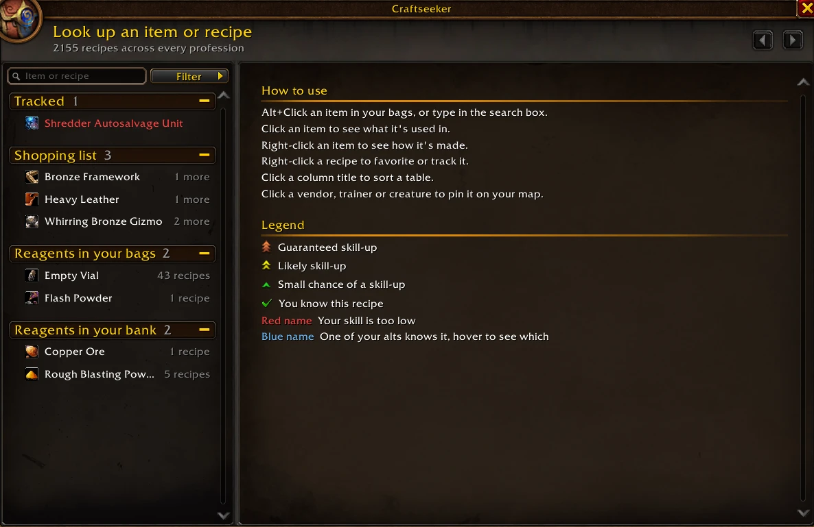
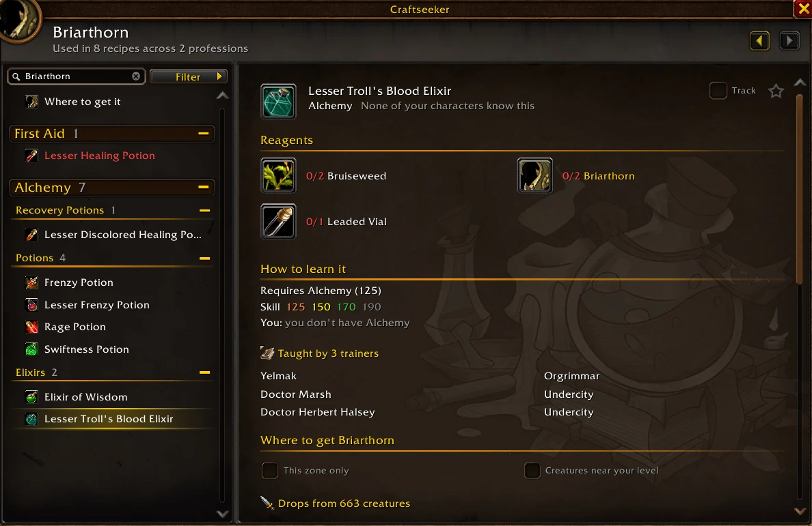
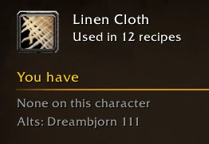
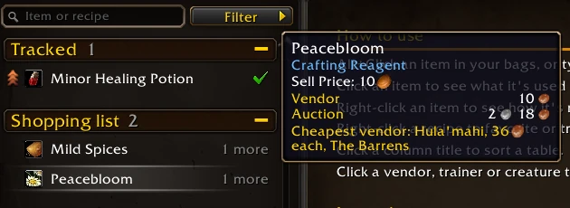
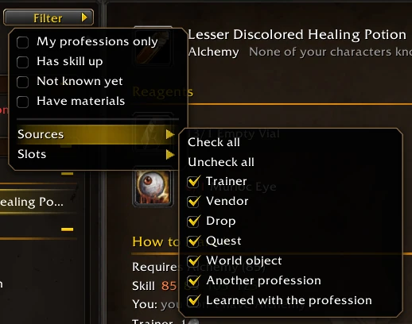
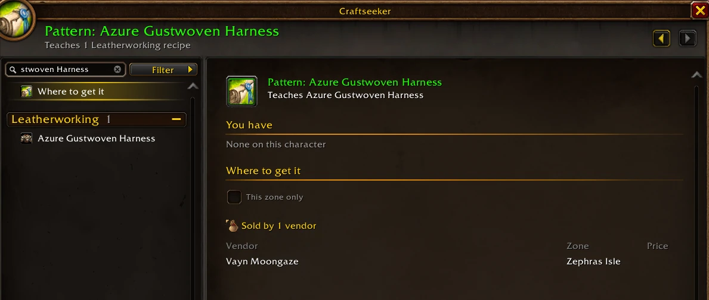
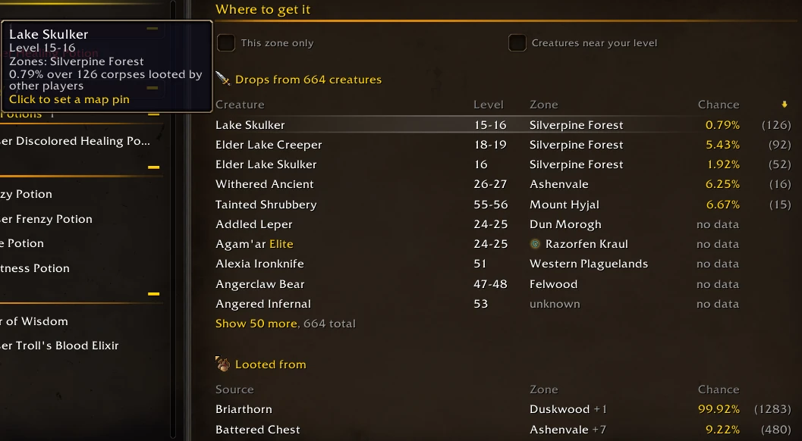
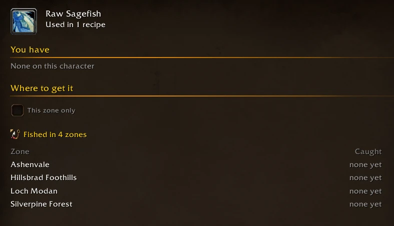
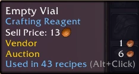

# Craftseeker
Craftseeker is a reagent and recipe browser for WoW: Forever, laid out like the profession window.

Alt+Click any item to see every recipe it goes into, how to learn each one, and where to get it.

---
What it shows:

- Recipes that use an item
- Recipes that make an item
- How to learn each recipe
- Where to get a reagent, with drop rates
- Chests and containers, with their rates
- Recipe items and what they teach
- Recipes in the profession window's categories
- Skill-up arrows
- Which of your characters know a recipe
- Reagent counts in your bags, bank and alts
- Shopping list for tracked recipes
- Map pins, TomTom too

---

The start page lists your favorite and tracked recipes, then the reagents in your bags and bank. Search for any item or recipe and narrow the lists with the Filter button. Sort source tables by clicking a column title, or limit them to your zone or creatures near your level. Hide any profession or class in the settings.

---

Drop rates improve as you play. Every loot, gathered node and catch is counted and shared with other Craftseeker users online.

Reagents in your bags and bank get one tooltip line saying how many recipes use them.

---

With [QuestieDB](https://github.com/Questie/QuestieDB) installed, Craftseeker also lists the creatures, vendors, chests and quests it knows.

---

## Commands:

- ` /cs ` — Open Craftseeker
- ` /cs <item link, ID or name> ` — Look up an item or recipe
- ` /cs options ` — Open the settings
- ` /cs minimap ` — Show / hide the minimap button
- ` /cs share ` — Turn sharing on / off
- ` /cs status ` — Check whether sharing works
- ` /cs stats ` — What's been learned so far
- ` /cs profiler ` — Open the profiler
- ` /cs reset ` — Wipe learned data; keeps favorites and settings
---

## FAQ

**Q: Why are some drop rates missing?**

**A:** A rate shows once someone has looted that creature. Rare drops fill in as more players loot.

 

**Q: Why don't I see the opposite faction's recipes?**

**A:** The factions can't trade, so they're hidden. Tick "Show opposite faction" in the settings to list them.

 

**Q: Why is a recipe I found missing?**

**A:** Recipes no player has seen on WoW: Forever yet stay hidden until you or two other Craftseeker users find them in game. Tick "Show unconfirmed recipes" in the settings to list them in grey.

 

**Q: How do I know which recipes I already know?**

**A:** Known recipes get a check mark. A blue name means one of your alts knows it — hover it to see who.

 

**Q: Sharing doesn't seem to work.**

**A:** Run `/cs status` to see whether the hidden channel works and what was sent and heard. "Show debug messages" in the settings prints more.

---

## Credits

- Drop rates and skinning: Drop Tables contributors, https://github.com/valcheffnet/DropTables (CC BY-SA 4.0), and the Polestar authors' Recorder sessions, https://github.com/fitzforge/polestar (CC BY 4.0). The rate, gathering and creature-place tables are shared under CC BY-SA 4.0.
- Drop Tables' database also carries data from Blackthornes Farmer, https://github.com/Blackthornes/Blackthornes_Farmer (MIT), and Everloot, https://everloot.app (CC BY-SA 4.0).
- Recipe sources: WhatsTraining, https://github.com/fusionpit/WhatsTraining (MIT).
- Trainers, vendors and creature names: Data from Efficient Games (https://efficient.games), licensed under CC BY 4.0.
- Creature places, quest names and givers, fishing zones: AllTheThings, https://github.com/ATTWoWAddon/AllTheThings (MIT).
- Libraries: Ace3, LibDataBroker, LibDBIcon, ChatThrottleLib and LibDeflate, each under its own licence in its `Libs` folder or file header; LibDataBroker states none.
- Full notices: `DATA-NOTICES.md`.

## License
The code is MIT (`LICENSE`); data licences are in `DATA-NOTICES.md`.

Made for WoW: Forever.
